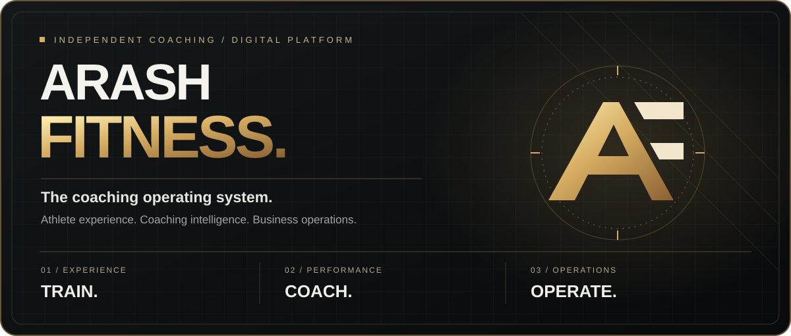
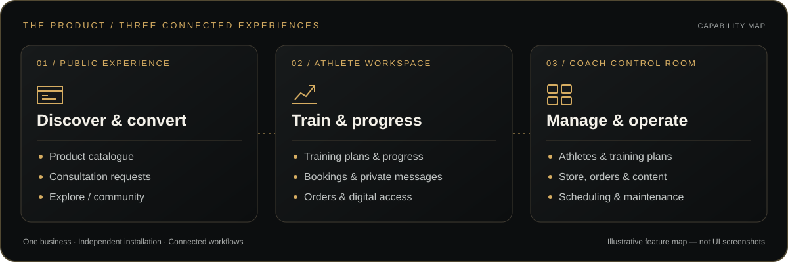
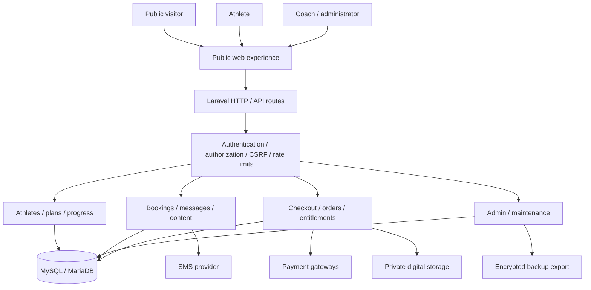
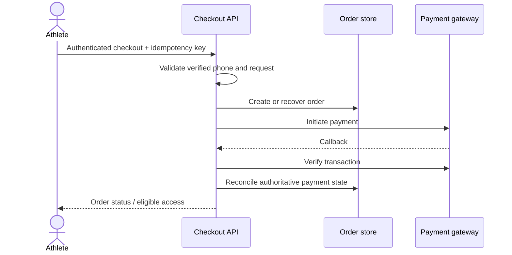

<!-- ARASH FITNESS | Product showcase + engineering field guide -->
<div align="center">



# ARASH FITNESS

**A premium digital coaching platform for independent fitness businesses.**

From the first consultation to the next personal best — one connected experience for athletes, coaches, and the business behind them.

[](docs/release/RELEASE_2_3_2_FA.md)
[](#release-confidence)
[](https://github.com/cianium/gym/actions/workflows/ci.yml)

[](laravel_core/composer.json)
[](laravel_core/composer.json)
[](#engineering)


[**Explore the product**](#the-product) · [**Preview branches**](#experience--preview) · [**Architecture**](#engineering) · [**Quick start**](#quick-start) · [**Release evidence**](#release-confidence)

</div>

---

## The product

> **More than a fitness website.** A purpose-built operating system for the coaching business: a public experience that converts interest into action, an athlete workspace that supports progress, and a control room that keeps the entire operation connected.



<table>
<tr>
<td width="33%" valign="top">

**01 / EXPERIENCE**

Public-facing experience

- Product catalogue
- Coaching consultation requests
- Explore-style content
- Likes and moderated comments
- Account registration and sign-in

</td>
<td width="33%" valign="top">

**02 / PERFORMANCE**

Athlete workspace

- OTP phone verification
- Assigned training plans
- Progress records
- Consultation booking
- Private coach messaging
- Order history and digital access

</td>
<td width="34%" valign="top">

**03 / OPERATIONS**

Coach & administration

- Athlete and plan management
- Availability and appointments
- Product and media management
- Order reconciliation
- Content moderation
- Backup, restore and revisions

</td>
</tr>
</table>

### The business loop

A visitor discovers the coaching brand. A verified athlete purchases a plan or books a session. The coach manages delivery, reviews progress and communicates privately. The platform supports the commercial and operational workflows around that relationship.

| Discover | Convert | Deliver | Retain |
| :--- | :--- | :--- | :--- |
| Public content & catalogue | Verified registration, checkout & bookings | Training plans, private downloads & coaching | Progress records, messages & repeat engagement |

## Experience & preview

This repository has **two distinct engineering tracks**. The current default branch contains the Laravel release; the new FTA foundation and static demos are separate development work.

| Track | Branch | Purpose |
| :--- | :--- | :--- |
| **Current application · 2.3.2** | [`main`](https://github.com/cianium/gym/tree/main) | Laravel application and compiled frontend |
| **Next-generation foundation** | [`migration/fta-v3-foundation`](https://github.com/cianium/gym/tree/migration/fta-v3-foundation) | NestJS / Next.js migration work |
| **FTA static preview** | [`demo/fta-pages`](https://github.com/cianium/gym/tree/demo/fta-pages) | Browser-only GitHub Pages publishing tree |
| **Original UI preview** | [`demo/original-ui-static`](https://github.com/cianium/gym/tree/demo/original-ui-static) | Original interface preview branch |
| **Client / admin preview** | [`demo/static-client-admin`](https://github.com/cianium/gym/tree/demo/static-client-admin) | Static client and administration preview |

> [!NOTE]
> Static previews are not production deployments. The FTA preview uses fictional records and has no live authentication, payments or backend. Do not enter real personal information. GitHub Pages is the intended first review environment; a server-side application requires separate hosting. The Pages branch link above opens its source, not a verified live deployment.

The visual identity in this README is an original documentation design. The feature map is illustrative, not a screenshot of the running application.

## Engineering

**One installation. One coaching business. One operational boundary.**

The current application is a single-tenant, white-label deployment. Each business can have its own domain, database, configuration, and service credentials. The application core is intentionally separated from the public document root.



*Logical component view of the Laravel release; not a network or infrastructure topology.*

| Layer | Current implementation |
| :--- | :--- |
| **Application** | Laravel 13 · PHP 8.3+ as declared in Composer |
| **Persistence** | MySQL 8+ / MariaDB 10.6+ target |
| **Delivery** | Compiled browser assets · Laravel HTTP/API routes |
| **Identity** | Separate administrator and athlete access paths · mobile OTP |
| **Commerce** | Zarinpal · Bank Saman (SEP) integration paths |
| **Communications** | MeliPayamak SMS integration · private messages |
| **Testing** | PHPUnit · PHP/JavaScript syntax · route and checkout checks · MySQL CI |
| **Hosting** | Split public root · cPanel/shared hosting target for 2.3.2 |

<details>
<summary><strong>Repository anatomy</strong></summary>

```text
gym/
├── laravel_core/
│   ├── app/                 # Controllers, models, services, policies
│   ├── bootstrap/
│   ├── config/
│   ├── database/            # Migrations and seeders
│   ├── installer/           # Installation flow
│   ├── resources/           # Application shell
│   ├── routes/              # Web, API, console
│   ├── tests/               # Regression and feature tests
│   ├── composer.json
│   └── .env.example
├── public_html/
│   ├── assets/              # Compiled browser assets
│   ├── media/
│   ├── index.php
│   ├── spa-shell.html
│   └── .htaccess
├── docs/
│   ├── branding/            # Repository visual identity
│   ├── deployment/
│   ├── history/
│   └── release/
├── .github/workflows/
└── README.md
```

</details>

> [!IMPORTANT]
> The original maintainable React/TypeScript frontend source is not present in the current Laravel release tree. Its compiled assets are included. Do not confuse the newer migration foundation with an already completed replacement of `main`.

## Trust & transaction integrity

Security is a release requirement, not a marketing claim. The existing code and audit describe these controls:

| Boundary | Design control |
| :--- | :--- |
| Identity | Session-protected athlete/admin paths; OTP-gated registration |
| Requests | CSRF middleware and endpoint rate limiting |
| Checkout | Authenticated, phone-verified athlete; payer phone matching; idempotency keys |
| Payments | Dedicated callback handling, transaction-state checks and reconciliation |
| Digital delivery | Ownership and entitlement checks, controlled tokens, revocation |
| Backup | Encrypted export; fail closed if no valid encryption key is configured |
| Deployment | Public-root separation; environment-specific secrets |

<details>
<summary><strong>Conceptual checkout sequence</strong></summary>



The diagram is a simplified successful-path illustration; pending, failed and reconciliation states are handled separately.

</details>

Keep application keys, database credentials, payment credentials, SMS credentials and `BACKUP_ENCRYPTION_KEY` out of source control. Preserve the backup key independently: losing it can make encrypted snapshots unrecoverable.

## Quick start

The following applies to the Laravel 2.3.2 branch, not the migration branch.

**Prerequisites:** Composer 2, the PHP version/extensions required by [composer.json](laravel_core/composer.json), MySQL or MariaDB, and an isolated local/staging database. Configure the web server to expose only `public_html/`.

```bash
git clone https://github.com/cianium/gym.git
cd gym/laravel_core

cp .env.example .env
composer install
php artisan key:generate

# Configure the dedicated database in .env first.
php artisan migrate
```

Configure writable Laravel storage/cache directories and the application URL, then serve the application through the repository's public entry point using your web server.

<details>
<summary><strong>Development checks</strong></summary>

Run from `laravel_core/` after installing development dependencies:

```bash
composer test
php tests/static_runtime_regressions.php
php tests/route_security_smoke.php
node tests/client_checkout_gate.mjs
```

The [CI workflow](.github/workflows/ci.yml) also defines a MySQL PHPUnit suite. It must run on a dedicated, disposable testing database; never point it at customer data.

</details>

### Deployment gates

- [ ] Expose only `public_html/`; keep `laravel_core/` and secrets private.
- [ ] Configure dedicated database, HTTPS, secure cookies, `APP_ENV=production` and `APP_DEBUG=false` for an eventual production installation.
- [ ] Configure environment-specific payment, SMS and backup credentials.
- [ ] Snapshot before database upgrades and verify scheduled tasks and permissions.
- [ ] Complete provider, restore, device and end-to-end staging verification before release.

> [!WARNING]
> **2.3.2 is a staging candidate, not production-approved.** Do not run destructive test suites against real data or connect real payment traffic until the release gates are cleared.

See the [deployment guide](docs/deployment/README.md) and [staging procedure](docs/release/STAGING_TEST_AND_DEPLOY_FA.md).

## Release confidence

<div align="center">

**ENGINEERING EVIDENCE / RELEASE 2.3.2**

<table>
<tr>
<td align="center" width="25%"><h2>30</h2>PHPUnit tests</td>
<td align="center" width="25%"><h2>146</h2>Assertions</td>
<td align="center" width="25%"><h2>41</h2>Static regressions</td>
<td align="center" width="25%"><h2>20</h2>JS asset checks</td>
</tr>
</table>

<sub>Historically recorded results from the November 22 repository audit; not newly executed by this README revision.</sub>

</div>

The [repository audit](docs/release/REPOSITORY_AUDIT_2026-11-22_FA.md) records successful MySQL 8.0.46 CI checks, PHP and JavaScript syntax validation, route smoke tests and client checkout regression checks. It also documents the backup encryption and MySQL migration corrections.

| Verification | Evidence / status |
| :--- | :--- |
| MySQL feature suite | 30 tests / 146 assertions recorded |
| Static regression suite | 41 checks recorded |
| Route security smoke | 4/4 recorded |
| Client checkout | 4/4 recorded |
| Real payment callbacks & reconciliation | Staging verification required |
| Real SMS delivery | Provider verification required |
| Full encrypted backup / restore | End-to-end verification required |
| Mobile and desktop browser workflows | End-to-end verification required |
| Hosting and scheduler | Target-environment verification required |

[Read the audit](docs/release/REPOSITORY_AUDIT_2026-11-22_FA.md) · [View CI](https://github.com/cianium/gym/actions/workflows/ci.yml) · [Review release gates](docs/release/RELEASE_CHECKLIST_FA.md)

## Documentation

| Reference | What it covers |
| :--- | :--- |
| [Repository audit · FA](docs/release/REPOSITORY_AUDIT_2026-11-22_FA.md) | Findings, corrections and test evidence |
| [Final QA report · FA](docs/release/FINAL_QA_REPORT_FA.md) | Release readiness and limitations |
| [Release 2.3.2 · FA](docs/release/RELEASE_2_3_2_FA.md) | Release scope |
| [Implementation status · FA](docs/release/IMPLEMENTATION_STATUS_FA.md) | Capability status |
| [Security & UI changes · FA](docs/release/CHANGES_SECURITY_UI_FA.md) | Security and interface changes |
| [Release checklist · FA](docs/release/RELEASE_CHECKLIST_FA.md) | Release gates |
| [Staging & deployment · FA](docs/release/STAGING_TEST_AND_DEPLOY_FA.md) | Validation and deployment procedure |
| [Deployment index](docs/deployment/README.md) | Hosting documentation |

<details>
<summary><strong>معرفی فارسی پروژه | Persian overview</strong></summary>

**آرش فیتنس** یک پلتفرم یکپارچه برای کسب‌وکارهای مربیگری ورزشی است که تجربه عمومی مشتری، پنل ورزشکار و ابزارهای مدیریت مربی را به یکدیگر متصل می‌کند.

مدیریت ورزشکاران، برنامه تمرینی، ثبت پیشرفت، رزرو مشاوره، پیام خصوصی، فروش محصولات، پرداخت، دسترسی به فایل‌های دیجیتال، مدیریت محتوا و نگهداری سیستم از قابلیت‌های نسخه فعلی هستند.

شاخه اصلی شامل نسخه Laravel 2.3.2 است و هنوز تأیید انتشار عملیاتی ندارد. بازطراحی FTA v3 و نسخه‌های نمایشی مستقل در شاخه‌های جداگانه توسعه می‌یابند. جزئیات فنی و وضعیت تست‌ها در مستندات فارسی بالا قابل مشاهده است.

</details>

## Ownership & usage

The Laravel project metadata declares a **proprietary** license. Public visibility of this repository does not itself grant permission to redistribute, resell or reuse its code or assets. Obtain written permission from the rights holder for reuse or distribution.

For project discussion, use the [repository issues](https://github.com/cianium/gym/issues) or contact the [maintainer](https://github.com/cianium). Do not publish secrets or sensitive security findings in public issues.

---

<div align="center">

**ARASH FITNESS**

### Build the athlete. Empower the coach. Elevate the business.

Maintained by **[cianium](https://github.com/cianium)**

<sub>Independent coaching · Product engineering · Built for the long run</sub>

[Back to top](#arash-fitness)

</div>
